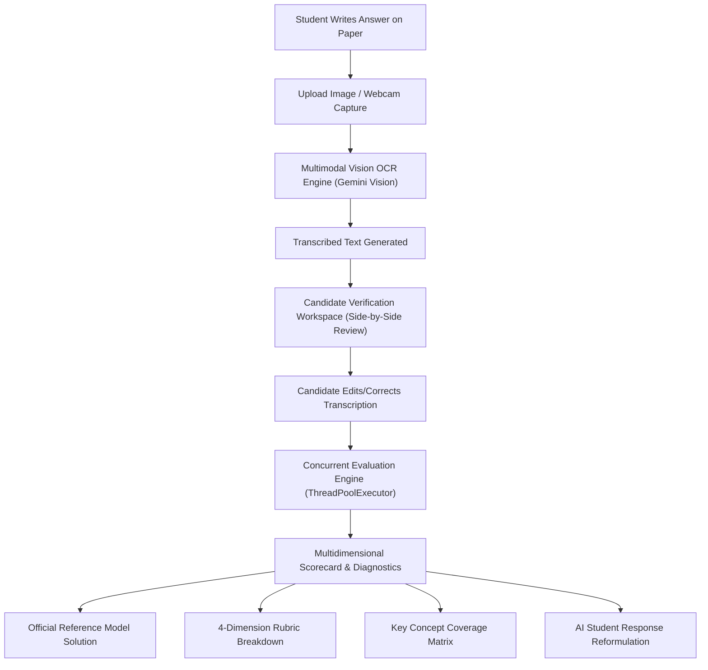

Milestone 1: Task 5 – Multimodal Handwritten Answer Submission & Vision AI Evaluation Suite
========================================================================================

1. Overview & Objective
-----------------------
In standard online examination platforms, students are constrained to typing text via keyboard or selecting multiple-choice answers. This limitation restricts subjects requiring handwritten derivations, diagrams, code blocks, or mathematical proofs.

Task 5 implements a Multimodal Examination System combining computer vision and generative AI. It allows candidates to write answers on physical paper, capture or upload the answer sheets, extract text through Vision OCR, review and edit the transcription, and receive multidimensional academic evaluation.

----------------------------------------------------------------------------------------

2. System Architecture & Data Flow
----------------------------------

----------------------------------------------------------------------------------------

3. Core Technical Components
----------------------------

A. Multimodal Vision OCR Engine:
* Model: Google Gemini Flash Lite Vision API (gemini-3.5-flash-lite / gemini-3.1-flash-lite).
* Functionality: Uses multimodal attention to transcribe handwritten answers, code formatting, indentations, and formulas from photos/scans.
* Prompt Engineering: The Vision model is constrained with an academic OCR prompt to return pure transcribed content without conversational filler.

B. Human-in-the-Loop (HITL) Verification & Editing:
* Rationale: Real-world camera captures may suffer from low lighting, slight blur, or handwriting ambiguities.
* Mechanism: Displays the uploaded image side-by-side with an editable text area.
* Student Control: Students can directly fix any misidentified words, append additional notes, or reset back to raw OCR before submitting.

C. High-Speed Concurrent Evaluation:
* Architecture: Implements Python's concurrent.futures.ThreadPoolExecutor.
* Parallel Execution: Dispatches multiple subjective questions simultaneously across parallel threads, reducing evaluation latency from 15–25 seconds down to ~2.4 seconds.
* Short-Circuit for Skipped Questions: Unattempted questions immediately bypass LLM calls, returning a zero-mark rubric in < 0.01 seconds.

----------------------------------------------------------------------------------------

4. 4-Dimensional Academic Evaluation Framework
----------------------------------------------

| Dimension | Weight | Focus | Description |
| :--- | :---: | :--- | :--- |
| Technical Accuracy | 40% | Factual & Conceptual Correctness | Validates core definitions, equations, mechanics, and logic. |
| Completeness & Depth | 30% | Keyword & Principle Coverage | Checks if all essential mechanisms and sub-parts are addressed. |
| Clarity & Vocabulary | 20% | Technical Precision | Evaluates subject-specific terminology, structure, and readability. |
| Practical Application | 10% | Examples & Real-World Use | Assesses concrete examples, syntax, or architectural context. |

----------------------------------------------------------------------------------------

5. Diagnostic Scorecard Deliverables
------------------------------------

1. Prominent Ideal Reference Model Solution (100% Score Standard):
   - Displays the official benchmark answer in an emerald card for immediate student review.
2. Concept Checklist Matrix (COVERED / PARTIAL / MISSED):
   - Itemized verification of syllabus-aligned concepts.
3. Targeted Strengths & Points to Improve:
   - Constructive feedback highlighting specific areas of mastery and omission.
4. AI Student Response Reformulation:
   - Re-expresses the student's exact answer into full-mark academic prose while retaining their natural voice.
5. Image Audit Trail:
   - Retains original image thumbnails alongside transcribed text for transparency and proctoring.

----------------------------------------------------------------------------------------

6. How to Run in VS Code
------------------------

Run Standalone Task 5:
streamlit run milestone1/task5.py

Run Standalone Task 4:
streamlit run milestone1/task4.py

Run Full Milestone Navigator:
streamlit run milestone1/app.py
